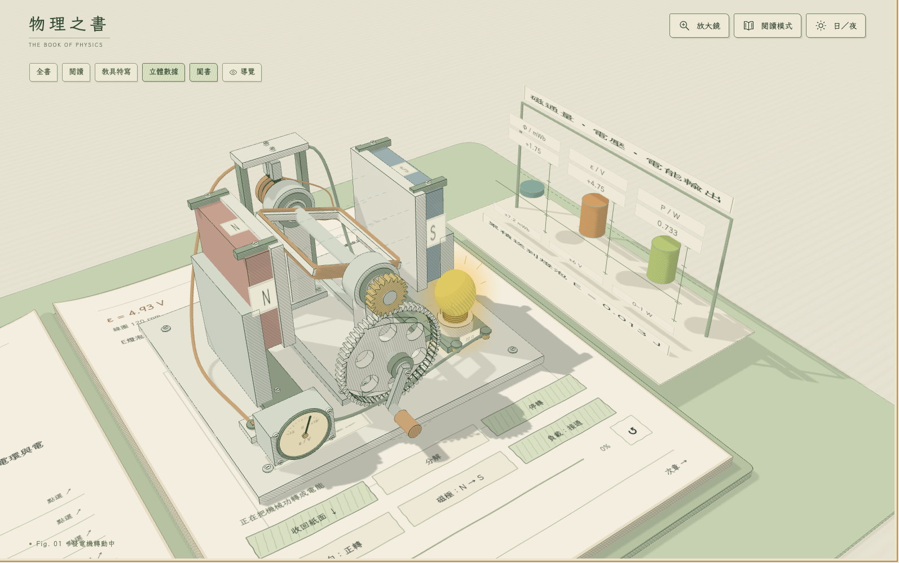

# 物理之書：手搖交流發電機

一本可以親手操作的手繪 3D 高中物理課本。發電機從書頁浮出，拖動搖柄即可觀察磁通量、感應電壓、交流週期與電能轉換。

**[線上操作](https://changyi123456.github.io/popup-physics-generator/)** · [離線單檔](dist/index.html) · [授權](LICENSE)



## 可以做什麼

- 旋轉、拆解與組裝真正的 3D 發電機，探索線圈、磁極、集電環、電刷、軸承與齒輪。
- 直接拖動立體搖柄，或點書頁上的「自動轉動」。
- 改變搖柄轉速、線圈匝數、磁場強度；反轉方向、交換磁極及切換負載。
- 右側書邊的立體量測架朝向裝置，以動態圓柱顯示磁通量 Φ、感應電壓 ε、輸出功率 P；Φ、ε 可跨過零點，P 保持非負。
- 觀察暖黃色燈泡隨負載功率明暗變化，並讀取送到燈泡的累積電能。
- 在第三章對照磁通量、電壓與功率的週期；第四章閱讀能量流向。
- 使用放大鏡、翻頁、掀紙看答案與完整文字讀本。手機提供可讀字級；不支援 WebGL 時保留圖文版。

所有表面採一致的手繪紙墨風格，含書本、機械、字體、操作與數據圖。

## 快速開始

下載專案後，直接以現代瀏覽器開啟 `dist/index.html`。這是約 7 MB 的完整離線單檔，已內嵌 Three.js、完整繁中手寫字型、程式與向量備援圖。

開發只需 Node.js 20 以上與 Python 3，不需 npm 安裝依賴：

```sh
node build.mjs --audit
npm run dev
```

本機網址為 `http://127.0.0.1:4188/`。GitHub Actions 會在推送 `main` 時重新建置、驗證物理模型並發布至 GitHub Pages。

## 操作

右頁控制浮出、分解、自動轉動、反向、磁極與負載；左頁滑桿調整參數。拖曳空白處環視，Shift 拖曳只旋轉裝置，滾輪縮放。點「立體數據」可同時近看裝置和圓柱量測架。

鍵盤：←／→ 翻章，Space 自動轉動，E 分解，P 浮出，B 闔書，M 放大鏡，R 重設，Escape 清除選取。

## 物理模型

每匝面積 80 cm²；預設 120 匝、0.45 T。60 齒搖柄齒輪帶動 20 齒轉軸齒輪，線圈轉速為搖柄的三倍。自動演示採 0.18 倍時間，讀值仍為物理轉速。

```text
Φ = BA cosθ
ε = −N dΦ/dt = NBAω sinθ
I = ε / (R線圈 + R負載)
P負載 = I² R負載
E負載 = ∫ P負載 dt
```

θ 相對固定的左→右方向量起；磁極交換以 B 的正負表示。均勻轉動時，Φ 與 ε 相差四分之一週期，電阻負載功率的週期為 T/2，因此每圈有兩次功率高峰。兩個半週都累積電能。

線圈電阻固定 4 Ω，燈泡以固定 22 Ω 電阻近似，忽略電感與機械摩擦。可見導線束代表多匝繞組；機械是教學幾何，適合探索原理。

`node build.mjs --audit` 驗證 2,416 項物理條件與 361 個實際線圈角度／齒輪比例姿態，包括法拉第微分、方向反轉、開路、楞次扭矩及即時與累積能量平衡。這些檢查不等同完整實體碰撞或製造公差驗證。

## 專案結構

| 檔案 | 工作 |
|---|---|
| `src/model.js` | 物理方程、能量積分、教材與模型驗證 |
| `src/generator.js` | 發電機、手搖機構、電表與燈泡 |
| `src/charts.js` | 沿右頁外緣、面向裝置的動態圓柱 |
| `src/book.js` | 彎曲紙張、印刷控制、週期圖與翻頁 |
| `src/ink.js` | 手繪排線、紙面明暗與輪廓 |
| `src/main.js` | 共用狀態、鏡頭與互動 |
| `src/lens.js` | 實際畫面的放大鏡 |
| `build.mjs` | 離線打包、向量備援與物理驗證 |

## 來源與致謝

- [OpenStax：Electric Generators and Back Emf](https://openstax.org/books/university-physics-volume-2/pages/13-6-electric-generators-and-back-emf)
- [教育部：高中物理法拉第電磁感應定律](https://market.cloud.edu.tw/resources/web/1812065)
- 立體書呈現靈感：[Techartist / Every Joule](https://iamtechartist.com/every-joule/)
- 工藝流程採 Anatomy、Spatial Pop-up Book 與 Mechanical Anatomy Book 的方法；原創教具幾何、互動與教材文字。

## 授權與改作

本專案原創程式與教材採 [MIT License](LICENSE)，歡迎教學使用、分享與改作。Three.js 與 Anatomy 繪圖工具採 MIT；LXGW WenKai TC 字型採 SIL Open Font License。請保留 [第三方授權資訊](THIRD_PARTY_NOTICES.md) 與字型授權。
